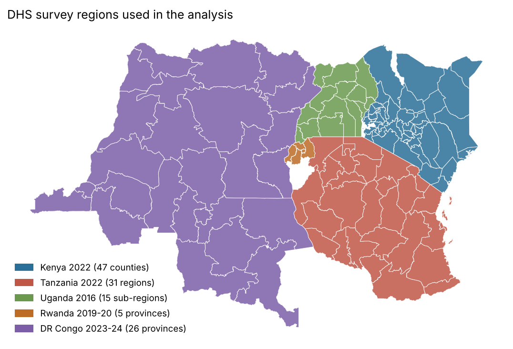

# Measuring Electrification from Space

**What nighttime lights reveal and miss about electricity access in East Africa**

Dayyan Lutshaka Fundi · Lake Forest College · James Rocco Quantitative Data Research Scholarship (2027 cycle)
Advisors: Dr. Andrew Gard (primary), Dr. Sugata Banerji (technical)

## The question

Researchers often use satellite images of light at night as a stand-in for electricity access. This project tests how well that works in Kenya, Tanzania, Uganda, Rwanda, and the Democratic Republic of the Congo by comparing VIIRS nighttime lights against household survey measures of access (DHS) and national estimates (World Bank), and maps the places where the satellite view overstates or understates access.



## Data

| Source | What it gives us | How we get it |
|---|---|---|
| VIIRS Annual Nighttime Lights V2.2 (Elvidge et al., 2021) | Annual radiance, about 500 m pixels | Google Earth Engine `NOAA/VIIRS/DNB/ANNUAL_V22` |
| World Bank WDI | National, urban, rural access, % of population | `src/download_worldbank.py` |
| DHS Program | % of households with electricity, by region | `src/download_dhs.py` |
| WorldPop | Population per 100 m grid cell | Google Earth Engine |
| Falchetta et al. (2019) | Published gridded electrification estimates | Direct download (comparison only) |

All sources are free and public. Download dates and versions are logged in `docs/data_inventory.md`.

## Repository layout

```
src/            Python scripts, run in numbered order (see below)
gee/            Google Earth Engine scripts that build the light measures
notebooks/      Exploratory notebooks (figures, checks); not required to reproduce results
data/raw/       Files exactly as downloaded (not edited by hand)
data/interim/   Cleaned and merged tables
data/processed/ Final analysis datasets
outputs/        Tables and figures used in the paper
docs/           Analysis plan, data inventory, notes
paper/          Paper drafts
```

## How to reproduce

1. Install Python 3.11 or newer, then install the packages:
   ```
   pip install -r requirements.txt
   ```
2. Pull the survey and national data:
   ```
   python src/download_worldbank.py
   python src/download_dhs.py
   python src/preliminary_stats.py
   ```
3. Build the nighttime light measures in Google Colab (free Earth Engine account needed):
   [](https://colab.research.google.com/github/fundidayyan-afk/Measuring-Electrification-from-Space/blob/main/notebooks/01_light_measures.ipynb)

## Status

- [x] Repository structure
- [x] World Bank and DHS download scripts
- [x] DHS region boundaries for all eight surveys (`src/download_boundaries.py`)
- [ ] Harmonize boundaries across survey waves
- [ ] Earth Engine light measures
- [ ] Models 1 to 3, prediction, robustness
- [ ] Interactive map (GitHub Pages)
- [ ] Paper

## License

Code: MIT. Data remain under the terms of their original providers.
